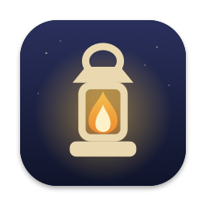
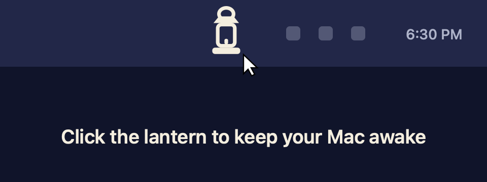

<p align="center">
  
</p>

<h1 align="center">Lamplight</h1>

<p align="center">
  Keep your Mac or Windows PC awake with one click. With the lid open or closed.<br>
  Free and open source. No account, no tracking, no paid upgrade.
</p>

<p align="center">
  <a href="https://github.com/Wu-Adam1234/lamplight/releases/latest">Download</a> ·
  <a href="#install-on-mac">Mac</a> ·
  <a href="#install-on-windows">Windows</a> ·
  <a href="#how-lid-closed-mode-works">How lid-closed mode works</a> ·
  <a href="#build-from-source">Build from source</a>
</p>

<p align="center">
  
</p>

## What it does

**Click** the lantern in your menu bar. The flame lights and your Mac stays awake until you click again. Downloads finish, builds keep running, remote sessions stay connected, and the screen stays on if you want it to.

**Right-click** (or Control-click) the lantern for timers and settings.

- **Until you turn it off, by default.** Or right-click and pick a length under **Turn On For**: 15 or 30 minutes, 1, 2, 4 or 8 hours. To make a plain click use a timer too, set **Turn On Lasts**.
- **Lid closed is fine.** Close the lid and everything keeps running, with no external display, keyboard or power adapter needed. You set it up once with your password ([how it works](#how-lid-closed-mode-works)).
- **Shows the time left** next to the lantern while a timer runs, if you want.
- **Keep Screen On** is optional. Turn it off to let the display sleep while the Mac stays awake.
- **Turns itself off on low battery.** It switches off at 10% by default, so a closed laptop in a bag doesn't run flat. You can pick 5, 20 or 30%, or never.
- **Puts everything back.** Turning it off, quitting, or a timer running out all restore normal sleep at once. If Lamplight is force-quit, the next launch restores it.
- **Opens at login**, if you like.

The lantern is lit while Lamplight is on and dark while it's off. The flame animates when it changes, unless **Reduce Motion** is on in Accessibility settings.

## Install on Mac

1. Download `Lamplight-<version>.zip` from the [latest release](https://github.com/Wu-Adam1234/lamplight/releases/latest) and unzip it.
2. Drag **Lamplight.app** into your **Applications** folder.
3. Open it. Lamplight isn't notarized by Apple (notarizing needs a paid developer account), so macOS will warn you the first time. Go to **System Settings → Privacy & Security**, scroll down, and click **Open Anyway**. Or run this once in Terminal:
   ```sh
   xattr -dr com.apple.quarantine /Applications/Lamplight.app
   ```
4. The lantern appears in your menu bar. That's the whole app.

**Can't see the lantern?** If your menu bar is full, macOS hides extra icons behind the notch or in the overflow. Quit a menu bar app or two, or check **System Settings → Menu Bar** and make sure Lamplight is allowed there.

## Install on Windows

1. Download `Lamplight-<version>-windows-x64.zip` from the [latest release](https://github.com/Wu-Adam1234/lamplight/releases/latest). Use the `arm64` zip on ARM laptops such as Snapdragon PCs.
2. Unzip it and put `Lamplight.exe` anywhere you like, for example in a `Lamplight` folder in your user folder.
3. Double-click it. Lamplight isn't code-signed (that costs money every year), so SmartScreen may warn you. Click **More info**, then **Run anyway**.
4. The lantern appears in the system tray next to the clock. If Windows hides it behind the **^** arrow, drag it onto the taskbar so it stays visible.

**Click** to turn it on or off, **right-click** for timers and settings, the same as on a Mac. There's nothing else to install: the .NET runtime is built into the exe.

Requires Windows 10 (version 1809 or later) or Windows 11.

### Lid-closed mode on Windows

Windows keeps running with the lid shut when your power plan's **When I close the lid** setting is **Do nothing**. While Lamplight is on, it switches that setting to **Do nothing** for both battery and plugged in. When it turns off, it puts back whatever you had before. It uses the built-in `powercfg` tool and normally needs no admin rights.

If Lamplight crashes or is ended from Task Manager, a small hidden helper puts your setting back within seconds. Lamplight also checks again the next time it starts. You can always check or change it yourself under **Settings → System → Power & battery → Lid & power button controls**.

Settings live in `%APPDATA%\Lamplight\settings.json`. **Start with Windows** adds Lamplight to your account's startup list; untick it to remove it.

Requires macOS 13 Ventura or later, on Apple silicon or Intel.

## How lid-closed mode works on Mac

Apps keep a Mac awake by holding a *power assertion*. Lamplight does that too. But macOS ignores those assertions when you close a laptop's lid: it sleeps anyway, unless an external display is attached. The only switch that changes this is the system setting behind `pmset disablesleep`, and only an administrator can flip it.

So the first time you use lid-closed mode, Lamplight asks for your password **once** and adds this single line to `/etc/sudoers.d/lamplight`:

```
yourname ALL=(root) NOPASSWD: /usr/bin/pmset -a disablesleep 1, /usr/bin/pmset -a disablesleep 0
```

That allows exactly two commands, with exactly those arguments, for your account only. After that, Lamplight runs `pmset -a disablesleep 1` when it turns on and `pmset -a disablesleep 0` when it turns off, without asking again. The line is checked with `visudo` before it's installed, so a broken file can never be left behind.

- **Remove it any time:** choose **Remove Lid-Closed Permission…** in the menu, or run `sudo rm /etc/sudoers.d/lamplight`.
- **Don't want it at all?** Click **Not Now**. Everything else works; your Mac will just sleep when you close the lid.
- **The code is short.** It's in [`Sources/LamplightCore/Core.swift`](Sources/LamplightCore/Core.swift) (`LidRule`) and [`Sources/Lamplight/System.swift`](Sources/Lamplight/System.swift) (`LidControl`). Please read it before you trust it.

> **Heat and battery.** A Mac with sleep switched off keeps running in a closed bag, and it gets warm. Lamplight turns off at the battery level you choose, but don't leave a closed, running laptop somewhere with no airflow. If you ever want to check that sleep is back to normal, run `pmset -g | grep SleepDisabled`. It should say `0`.

## Privacy

Lamplight makes no network connections on either platform. It has no analytics or crash reporting, and it collects nothing. On Mac its settings live in `~/Library/Preferences/io.github.wu-adam1234.lamplight.plist`; on Windows in `%APPDATA%\Lamplight\settings.json`.

## Build from source

You need Xcode 15 or later (or the Swift 5.10+ command line tools).

```sh
git clone https://github.com/Wu-Adam1234/lamplight.git
cd lamplight
make test      # unit tests
make app       # builds dist/Lamplight.app (universal) and a release zip
make install   # copies it to /Applications
```

`swift run` also works for quick testing, but **Open at Login** only works from a real app bundle.

**Windows app.** You need the [.NET 8 SDK](https://dotnet.microsoft.com/download/dotnet/8.0). It builds on Windows, macOS or Linux:

```sh
dotnet test windows/Lamplight.Core.Tests     # unit tests
scripts/build-windows.sh                     # dist/Lamplight-<version>-windows-x64.zip and -arm64.zip
```

### Project layout

| Path | What's in it |
| --- | --- |
| `Sources/LamplightCore/` | Pure logic: session lengths, time text, the sudoers rule, the battery cutoff. Fully unit tested. |
| `Sources/Lamplight/` | The menu bar app: menu, timers, power assertions, the `pmset` switch, battery reading. |
| `Tests/LamplightCoreTests/` | Unit tests, including one that runs the real `visudo` against the rule. |
| `scripts/render-icon.swift` | Draws the app icon and social card in code. No image files to keep in sync. |
| `scripts/build-app.sh` | Builds, bundles, ad-hoc signs and zips the app. |
| `windows/Lamplight.Core/` | Windows logic: session lengths, time text, the battery cutoff, the `powercfg` lid setting, settings file. |
| `windows/Lamplight.Windows/` | The Windows tray app (WinForms): tray icon, menu, timers, power requests. |
| `windows/Lamplight.Core.Tests/` | Unit tests for the Windows logic (xUnit). |
| `scripts/build-windows.sh` | Builds and zips the self-contained Windows app. |
| `docs/` | The project website (GitHub Pages). |

## Uninstall

**Mac**
1. Choose **Remove Lid-Closed Permission…** from the menu, if you set it up.
2. Quit Lamplight and drag it from Applications to the Trash.
3. Optional: `defaults delete io.github.wu-adam1234.lamplight` to remove its settings.

**Windows**
1. Untick **Start with Windows** in the menu, if you turned it on, then choose **Exit**.
2. Delete `Lamplight.exe`.
3. Optional: delete the `%APPDATA%\Lamplight` folder.

## Contributing

Bug reports and pull requests are welcome. See [CONTRIBUTING.md](CONTRIBUTING.md). Security issues: see [SECURITY.md](SECURITY.md).

## License

[MIT](LICENSE) © 2026 Adam Wu
